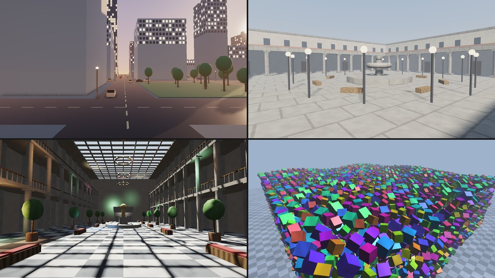
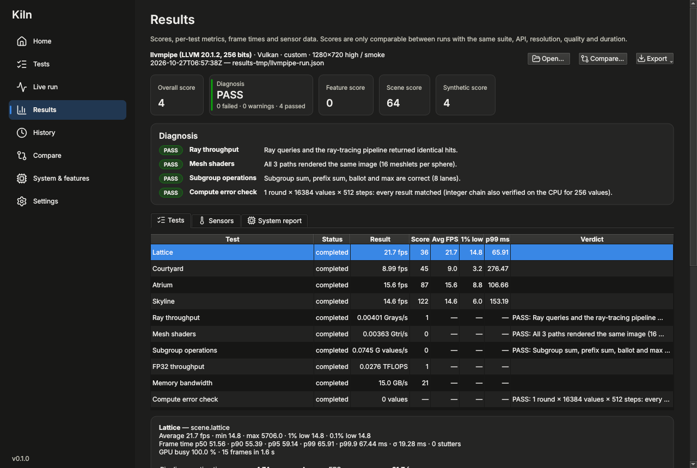
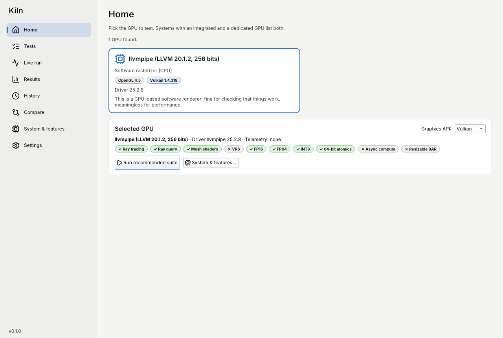

# Kiln

**Kiln** (working name) is a free, open-source (MIT) GPU benchmark, feature tester and stress / diagnostic tool for
AMD, NVIDIA and Intel GPUs on Linux and Windows.



- **Scene benchmarks** from OpenGL 3.3 / Direct3D 11 class rendering up to GPU-driven, ray-traced and path-traced
  Vulkan / Direct3D 12 scenes, with frame-time percentiles, 1% / 0.1% lows, stutter counts and scores.
- **Feature tests** that check the result as well as the speed: ray tracing (ray queries vs pipelines, BVH builds,
  SER, opacity micromaps), mesh shaders, variable-rate shading, sampler feedback, work graphs, cooperative matrix,
  subgroups, bindless, async compute, pipeline compilation, FSR 1 and upscaler plugins, HDR output, and the video
  engines (H.264, H.265 and AV1 decode and encode through Vulkan Video and Direct3D 12 Video).
- **Synthetic tests**: FP32 / FP16 / FP64 / INT32 / INT8-dot throughput, memory bandwidth and latency, atomics,
  pixel and texel fill, geometry, MSAA and transfers.
- **Diagnostics for the repair bench**: VRAM tester, rendering-artifact detection, compute error check, thermal
  soak and PCIe link check, with clear PASS / FAIL verdicts and a hardware report script.
- **Results** you can keep: live charts, telemetry (clocks, temperatures, power, fans) where the driver offers it,
  run history, side-by-side comparison, and JSON / CSV / HTML export.

| | |
|---|---|
|  |  |

> Status: version 0.1, under active development. The code is tested in CI on software renderers (lavapipe,
> llvmpipe, WARP); results on real GPUs are being collected ([docs/HARDWARE_TESTING.md](docs/HARDWARE_TESTING.md)).
> Progress: [docs/PROGRESS.md](docs/PROGRESS.md).

## Download

Releases are on the [Releases page](https://github.com/oreo1298/GPUTest/releases). Every push to `main` also builds
every package — open the latest [CI run](https://github.com/oreo1298/GPUTest/actions/workflows/ci.yml) → Artifacts.

| System | Package | How to run |
|---|---|---|
| Windows 10 / 11 (x64) | `Kiln-<version>-…-setup.exe` (installer) | Run it; Kiln is in the Start menu. No administrator rights needed. |
| Windows 10 / 11 (x64) | `Kiln-<version>-…-portable.zip` | Unzip anywhere and run `kiln.exe`; settings and results stay in that folder. |
| Linux (x86_64) | `Kiln-<version>-…-x86_64.AppImage` | `chmod +x Kiln-*.AppImage && ./Kiln-*.AppImage` |
| Linux (x86_64) | `Kiln-<version>-x86_64.flatpak` | `flatpak install --user Kiln-*.flatpak && flatpak run io.github.oreo1298.Kiln` |
| Arch, CachyOS, EndeavourOS, Manjaro | `packaging/arch/PKGBUILD` | See below. |

You need a current GPU driver: Vulkan for most tests on Linux, Direct3D 12 / Vulkan on Windows. Older GPUs run the
`legacy` suite through OpenGL 3.3+ or Direct3D 11.

### Install on Arch Linux (and CachyOS, EndeavourOS, Manjaro)

Run these as your normal user (not root); `makepkg` asks for your password when it installs the package:

```sh
sudo pacman -S --needed base-devel git
git clone https://github.com/oreo1298/GPUTest.git
cd GPUTest/packaging/arch
makepkg -si
```

This builds Kiln from the checkout and installs the `kiln` app (with a **Kiln** entry in your application menu),
the `kiln-run` command-line runner and the `kiln-hw-report` hardware report script. The build downloads its pinned
libraries and the Slang shader compiler, and takes a few minutes.

Dependencies (pulled in automatically) include `qt6-base`, `qt6-svg`, `qt6-wayland` and `vulkan-icd-loader`. You
also need the Vulkan driver for your GPU: `vulkan-radeon` (AMD), `vulkan-intel` (Intel) or `nvidia-utils` (NVIDIA),
which also provides NVML for NVIDIA clocks, temperatures and power.

To update later, pull the new code and build again from the same folder:

```sh
cd GPUTest/packaging/arch
git pull
makepkg -sif
```

`-f` rebuilds even when the version number has not changed (it only changes for releases). If `makepkg` says
`PKGBUILD does not exist`, you are not in the `GPUTest/packaging/arch` folder. To uninstall: `sudo pacman -R kiln`.

### Other Linux distributions

Use the AppImage or the Flatpak bundle, or build from source: [docs/BUILDING.md](docs/BUILDING.md).

## Quick start

Open **Kiln**, pick the GPU and API on the Home page and press **Run recommended suite**. When it finishes, the
Results page shows the scores, every test's metrics and verdict, frame-time charts and the sensor data; History keeps
every run, and Compare puts two runs side by side.

Everything the app does goes through the `kiln-run` command-line runner, so it can also be scripted:

```sh
kiln-run --list-devices                  # GPUs per API
kiln-run --check-support                 # which tests this GPU / API can run, and why not
kiln-run --suite standard                # the recommended suite (scores, results in the data folder)
kiln-run --suite diagnostics --api vulkan --gpu 1
kiln-run --test scene.skyline --resolution 1440p --quality ultra --loop 20m
kiln-run --export-html results.json report.html
```

## Documentation

- [User guide](docs/USER_GUIDE.md): suites, settings, reading the results, diagnostics, telemetry, where files are
- [Command line](docs/CLI.md) and [results format](docs/RESULTS_SCHEMA.md)
- [Scoring](docs/SCORING.md) and [upscaler plugins](docs/PLUGINS.md)
- [Building from source](docs/BUILDING.md) and [contributing](CONTRIBUTING.md)
- Design decisions: [docs/DECISIONS.md](docs/DECISIONS.md); plan: [docs/PLAN.md](docs/PLAN.md)

## License

MIT — see [LICENSE](LICENSE). Third-party components and their licenses: [THIRD_PARTY.md](THIRD_PARTY.md).
