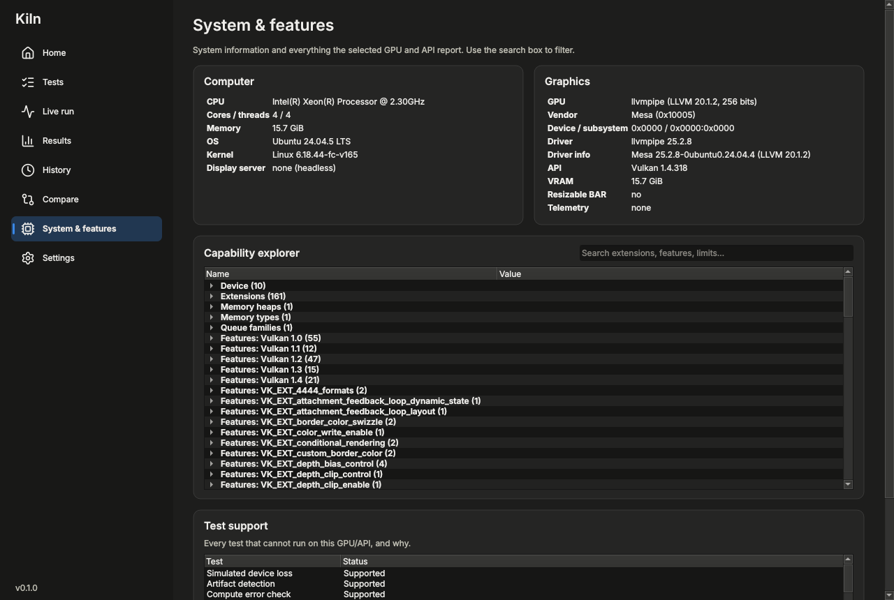

# User guide

Kiln measures how fast a GPU is, checks that its features give correct results, and finds faults. This page
explains the pieces; [CLI.md](CLI.md) lists every runner option and [SCORING.md](SCORING.md) how numbers become
scores.

## The app

| Page | What it is for |
|---|---|
| **Home** | Pick the GPU (systems with an integrated and a dedicated GPU list both) and the graphics API, see the key features at a glance, run the recommended suite. Software renderers are labelled: fine for checking that things work, meaningless for performance. |
| **Tests** | Choose a suite or individual tests, the resolution, quality, duration and loops. Tests the GPU / API cannot run are shown with the reason. |
| **Live run** | Progress, the current test's frame times and live sensor charts; Stop keeps everything finished so far. |
| **Results** | Scores, the diagnosis (PASS / WARN / FAIL per check), every test's metrics, frame-time charts and distribution, sensors during each test, loops and the system report. Export to HTML, CSV or JSON. |
| **History** | Every run in the results folder, with a filter: open one, compare two, see the score history of comparable runs, forget or delete runs. |
| **Compare** | Two runs side by side, test by test, with the differences. |
| **System & features** | Computer and GPU details, the full capability list of the API (extensions, features, limits) with a search box, and which tests are supported. |
| **Settings** | Theme and temperature unit, safety limits, what to do when the GPU resets, the results folder. Kiln has no telemetry, accounts or network access: results stay on the computer. |

The app runs every benchmark in a separate process (`kiln-run`), so a driver crash cannot take the app or your
results with it.

## Suites

| Suite | Contents | Typical time |
|---|---|---|
| `quick` | The main scenes and core synthetic tests at short durations | a few minutes |
| `standard` | The recommended suite: scenes, synthetic and feature tests | |
| `extreme` | Heavier settings and longer runs for high-end GPUs | longer |
| `raytracing` | Every ray-tracing scene and feature test | |
| `legacy` | Tests that run on older GPUs and APIs (OpenGL 3.3+, Direct3D 11) | |
| `compute` | Compute throughput, memory bandwidth and latency, matrix tests | |
| `diagnostics` | Repair-bench checks (below) | depends on the duration |
| `full` | Every test the selected GPU and API support | |

Scores are only comparable between runs with the same suite, API, resolution, quality and duration (the Results and
Compare pages say when two runs differ). Each test's score is 1000 × its result relative to a fixed reference, and
the suite score is the geometric mean, so one very fast or slow test cannot dominate.

## The scenes

| Scene | APIs | What it stresses |
|---|---|---|
| Lattice | all | Thousands of instanced, animated blocks: pure rasterization, CPU-light |
| Courtyard (and *lite*) | all | Classic forward renderer with a shadow map, fog and tessellated terrain, one draw call per object (the *lite* version instances, to measure the GPU rather than the CPU) |
| Atrium (and *lite*) | all | Classic deferred shading with hundreds of moving point lights |
| Skyline | Vulkan, D3D12 | GPU-driven city: GPU culling, indirect draws, PBR, cascaded shadows, AO and bloom on the async compute queue |
| Glasshouse | Vulkan, D3D12 | Hybrid rendering: mesh-shader grass, variable-rate shading, ray-traced shadows, AO and reflections |
| Gallery | Vulkan, D3D12 | Real-time path tracing with a denoiser |

Scenes report average FPS, 1% and 0.1% lows, frame-time percentiles, stutters and GPU busy time. `--upscale fsr1`
renders below the target resolution and upscales with AMD FSR 1.

## Feature tests

Feature tests check the result as well as measuring: the ray-tracing tests compare ray queries with the ray-tracing
pipeline, the mesh-shader test compares three paths that must draw the same image, the video test decodes reference
streams that must match FFmpeg's decode bit for bit, and so on. A failed check is a FAIL verdict even when the speed
looks fine. Tests for features the GPU lacks are skipped with the reason (`kiln-run --check-support` lists them).

## Diagnostics (the repair bench)

Run the `diagnostics` suite (Tests page, or `kiln-run --suite diagnostics`). Each check ends with PASS, WARN or FAIL
and says why.

| Check | Finds |
|---|---|
| VRAM test | Bad memory cells, unstable memory overclocks and addressing faults (walking bits, moving inversions, random data, address-in-address over the free VRAM; `--param diag.vram.mb=N` sets the size) |
| Artifact detection | Calculation errors under load: one reference frame is re-rendered while the GPU is busy and every pixel must match |
| Compute error check | Long integer and floating-point chains on every shader core, checked against the CPU and earlier rounds |
| Thermal soak | Temperatures, clocks, throttling and performance drop once the card is hot (5 minutes at Standard, 20 at Extreme; `--param diag.soak_s=N`) |
| PCIe link check | Transfer speed and whether the link runs at the generation and width the card supports (riser cables, wrong slots and lane sharing often halve it) |

`kiln-run` exits with code 7 when a check fails, so scripts can tell. To keep a record of a card, run the hardware
report: `kiln-hw-report` (Linux) or `hw-report.ps1` (Windows, in the install folder). It runs a validation suite on
every GPU and bundles the results, logs, system information and rendered frames into one archive.

`--loop 30m` (or `inf`) repeats a suite for burn-in: each loop is scored, and the Results page shows the stability
(worst loop ÷ best loop) and the trend.

## Sensors (telemetry)

Kiln reads the GPU's sensors while tests run and shows them live and in the results:

- **NVIDIA** (Linux and Windows): clocks, temperatures, power, fan, utilisation and throttle reasons through NVML,
  which comes with the driver.
- **AMD and Intel on Linux**: through the kernel drivers (amdgpu, i915, xe) — what the driver exposes varies by GPU.
- **AMD and Intel on Windows**: no sensor data yet.

VRAM use comes from the graphics API on every GPU. Without sensors everything still runs; the safety cutoffs then
cannot act.

## Safety

By default a run stops if the GPU passes 90 °C, the hotspot 105 °C or the memory 100 °C for two seconds; the partial
results are kept. Change the limits in Settings or with `--max-temp`, `--max-hotspot`, `--max-mem-temp`,
`--max-power`. If the driver resets the GPU (a device loss / TDR), the run records it and either stops or, with
`--on-device-lost recover`, continues with the next test.

## Where things are

| | Linux | Windows |
|---|---|---|
| Results and history | `~/.local/share/kiln/` | `%LOCALAPPDATA%\kiln\` |
| Settings | `~/.config/kiln/` | `%APPDATA%\kiln\` |
| Flatpak | `~/.var/app/io.github.oreo1298.Kiln/` | |
| Portable zip | | `data\` and `config\` next to `kiln.exe` (because of `portable.txt`) |

Each run is one JSON file in `results/` (format: [RESULTS_SCHEMA.md](RESULTS_SCHEMA.md)), written after every test,
so a crash never loses finished tests.

## Troubleshooting

- **My GPU is not listed** — update the graphics driver; on Linux install its Vulkan driver (`mesa-vulkan-drivers`,
  `vulkan-radeon`, `vulkan-intel` or the NVIDIA driver). `kiln-run --list-devices` shows what each API sees.
- **A test is skipped** — the reason is in the results and in `kiln-run --check-support`; usually the GPU or driver
  lacks the feature, or the API does not offer it.
- **It says software renderer** — the system is using llvmpipe / lavapipe / WARP instead of the GPU (missing driver,
  remote desktop, or a virtual machine).
- **The run stopped with "device lost"** — the driver reset the GPU. Repeated losses on a stable driver point at
  hardware or an unstable overclock; the diagnostics suite helps narrow it down.
